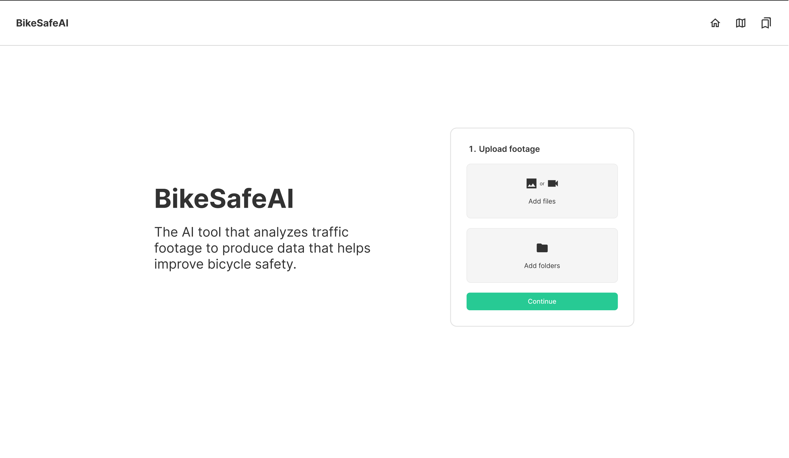
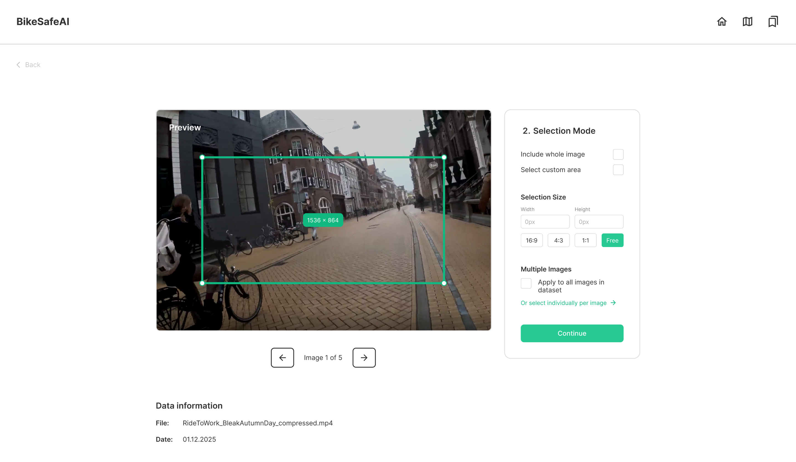
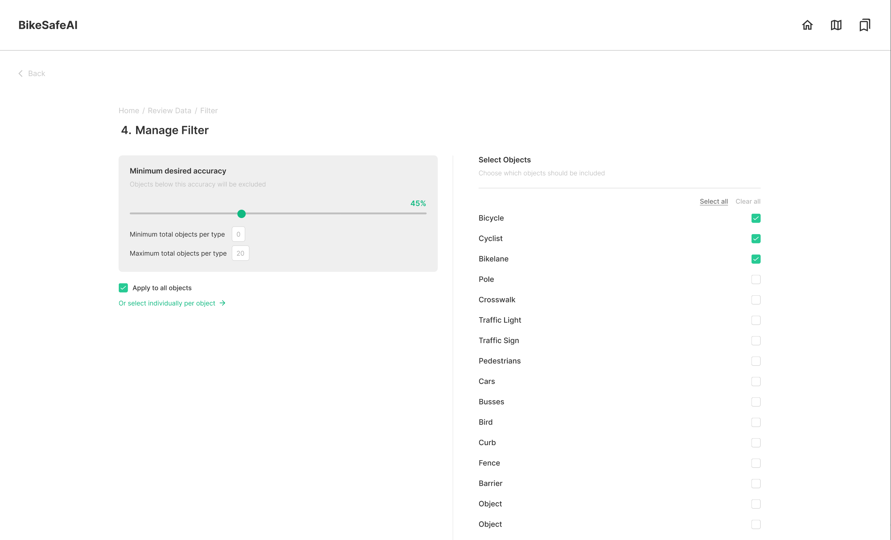
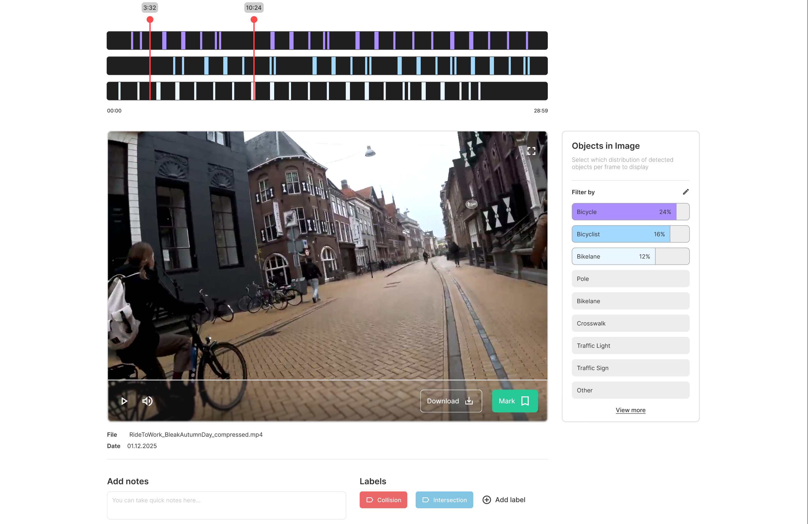
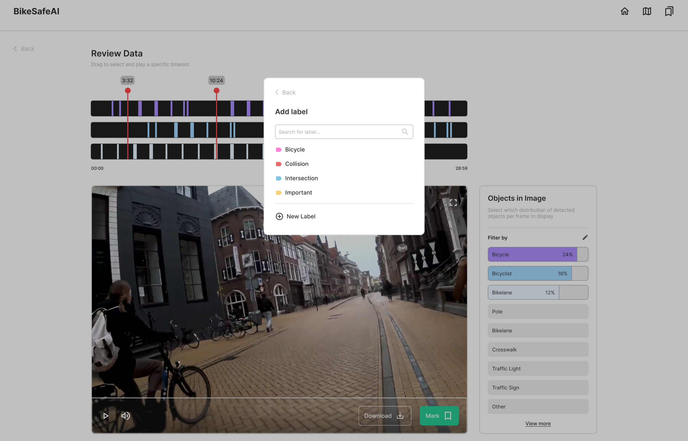
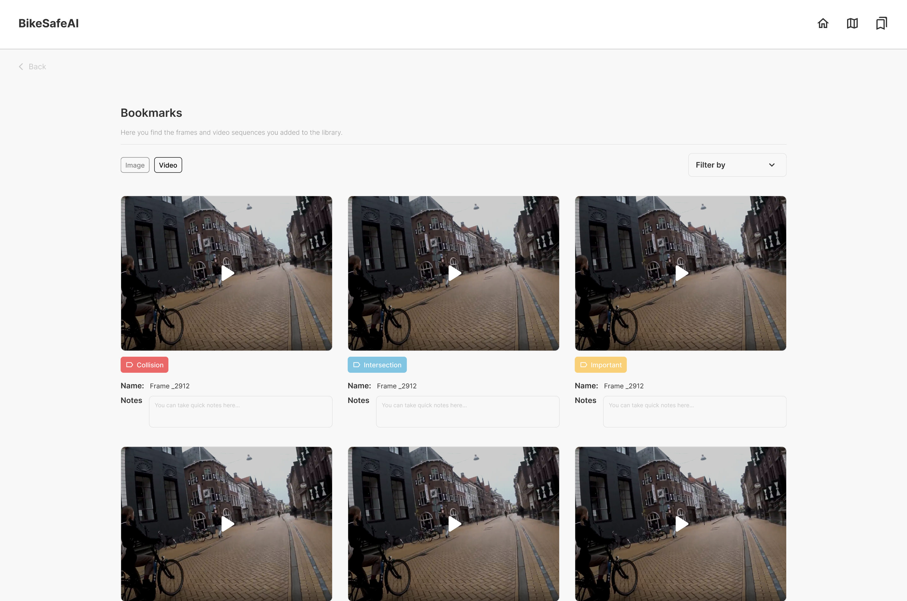

# Introduction

Here, some screenshots of a design for a UI are shown.The design is made in Figma and focusses on how to process a video using image segmentation or anomaly detection, and how to use the results to identify and select meaningful moments in a video. 

The design was created by students of CMGT (Creative Media and Game Technologies) of the Hanze:
- Stan van de Nadort
- Sandy Nguyen
- Valeriya Petrova
- Andreea Călin
- Katrin Todorova

## 1. Processing the video

At the start, a video or folder of frames can be selected. This brings the user to a menu that guides them through applying image segmentation or anomaly detection to the footage. The user can select the folder where the results must be stored. 

When footage was already processed, the folder with the results can be opened directly. Depending on the application (anomaly detection or image segmentation), this leads to the corresponding functionality as shown below. 

## 2. Anomaly detection
Anomaly detection will detect moments in a video in which something happened that deviated from 'normal', where 'normal' behavior was indicated by the user during the previous step. 

The anomalies that are found are displayed in the tool like this:

All parts of the video where anomaly detection found an anomaly, are highlighted as green in the top black bar. This black bar shows the duration of the video, and the red marker shows the current location in the video. 

With the arrows, the user can flip through the highlighted moments (which are the anomalies as indicated by the AI-model). Each segment can be played and then be marked as interesting or be skipped if it is not relevant.

## 3. Image segmentation
The results of image segmentation are visualized in a similar way as with the anomalies. However, there is some additional functionality to filter for precisely what a user is looking for. 

In this screen, the user can indicate what part of the frame they want to focus on. They can select the whole frame, or narrow it down by sizing the green box as desired. 

This can for example be useful when looking for 'bike poles', small poles that are placed in the middle of bike lanes. By narrowing down the search area, other poles (such as street lights on the side of the road) will be skipped. 

 

In the screen above, the user can select the items they are looking for. For example, the user could be interested in segments where there are bikes on a bikeline. 

The screen above is the main screen of the image segmentation-tooling. For the selected items, the black bars on top show where these are found in the video. With the red selection markers, segments can be selected, that will then be played below. The user can mark the segment and add relevant labels and notes to it. Furthermore, they can download a segment. 

By clicking on 'add labels', the following screen appears: 

Here, the user can define and organize their own labels. 

In the top of the screen to the right, there's a bookmark button. When this is clicked, the bookmark page opens up:

Here, the user can find all selected fragments, filter by label, play them, add extra notes, etc. This is where the user can make a selection of footages that will be relevant for the task(s) at hand. 

For example, the user can select all videos of collisions/near misses, and process each of those with (AI-)tooling that computes time to collision. Such further processing steps are currently not implemented. 