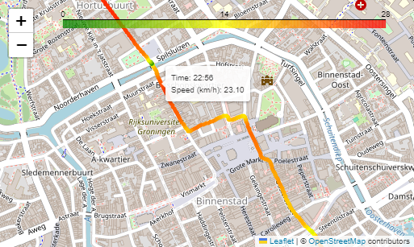
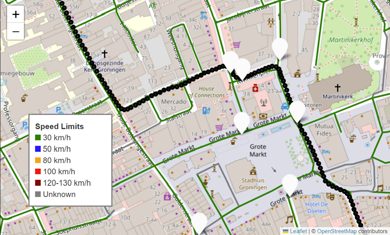

# Readme

In this folder, there are two notebooks that show how the GPS data corresponding to a movie (for example, when recorded with a GoPro) can be used to find and select interesting segments of the video, either by location, speed, or by adding features of the NWB (Nationaal WegenBestand). 

The notebooks are based on functions defined in the other files in this folder. Furthermore, they assume the GPS data is already extracted from the movie and stored in a .gpx file. See instructions below. 


## Visualize GPS, add speed, select segments based on location
In the notebook `1_visualize_gps_and_speed.ipynb`, it is demonstrated how to:
- Read .gpx, visualize on map
- Determine speed/acceleration based on GPS data
- Use GPS location and speed to select movie segments

The figure below gives an example. The tooltip relates the geographic position to the corresponding timestamp in the video. Additionaly, speed can be added.  



## Combine GPS with NWB 
In the notebook `2_combine_gps_with_nwb.ipynb` it is demonstrated how GPX data can be combined with road properties (*NWB wegkenmerken*), to help identify moments of interest. 

The figure below is an example screenshot, where the gps route is marked (black dots), the white markers are crosswalks ('zebrapaden') and the roads are colored by the speed limits: 




# Extract .gpx from (GoPro) movie
To extract the gps-data from a (GoPro) movie (stored in .gpx file), exiftool can be used. Furthermore, the file [gpx.fmt](https://github.com/exiftool/exiftool/blob/master/fmt_files/gpx.fmt) is needed. This is an ExifTool print format file used to define how GPS data should be formatted and output as a GPX track log when extracting metadata from files (e.g., photos or videos) using ExifTool. 

Note: to get gps-data from a GoPro movie, the movie must be non-compressed! 

Example of usage on MOVIE.MP4, assuming gpx.fmt and MOVIE.MP4 are both in the current directory: 
```bash
exiftool -ee -p gpx.fmt MOVIE.MP4 > route.gpx
```

Or in case of a large file:
```bash
exiftool -ee -api largefilesupport=1 -p gpx.fmt MOVIE.MP4 > route.gpx
```

### Other useful commands with exiftool:
1. Show other metadata as well: 
```bash
exiftool -ee -v MOVIE.MP4
```
2. Get all embedded metadata: 
```bash
exiftool  -a -u -g1 -ExtractEmbedded MOVIE.MP4
```
3. Get gyroscope data and store it in gyroscope.txt (to get accelerometer data, replace -Gyroscope with -Accelerometer):
```bash
exiftool -ExtractEmbedded -Gyroscope MOVIE.MP4  -b  -api largefilesupport=1 > output.txt 
```
