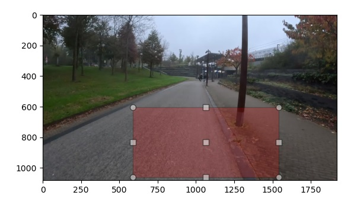

# Bounding Box Selection

This folder contains two Python utilities for **interactive bounding box selection** and **drawing bounding boxes on images**. These tools are useful for any workflow requiring manual region selection, such as querying segmentation results on a specific area of the images (for example, focus only on the part right in front of the bike). 

## Contents
- `select_bounding_box.py`  
  Allows the user to **interactively select a bounding box** on an image. The selected bounding box is printed in in `(xmin, ymin, xmax, ymax)` format. See the figure below for an example. 

- `draw_bounding_box.py`
  Draws a selected **bounding box on an image** and optionally saves the annotated image.

